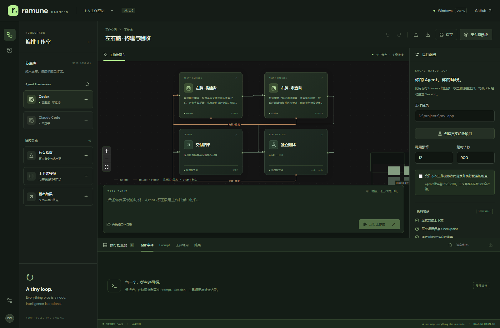

# Ramune Harness

**A tiny loop. Everything else is a node. Intelligence is optional.**

现有 AI Agent Harness 的轻量、可视化、可观察编排平台。使用 React Flow 连接构建者、审查者与独立检查，让已有 Codex / Claude Code / OpenClaw 在真实工作目录中协作。



## 本机体验

- Windows：[打开工作室](http://127.0.0.1:4317)
- WSL Ubuntu：[打开工作室](http://127.0.0.1:4318)

两套服务独立发现各自环境的 CLI、凭据与工作目录。首次进入后点击“创建真实验收项目”，勾选目录执行授权，再运行工作流；也可以填写已有项目路径，并修改独立检查卡片的可执行文件和参数。两张卡可以使用同一 Harness 的两个独立 Session。

## 功能

- 真实 PATH 发现与原生登录诊断；Codex、Claude Code 流式适配，OpenClaw 原生 agent exec 与隔离 transcript 适配。Gemini/OpenCode 只显示发现结果，不标记为可执行。
- 从现有私有代理配置读取真实模型目录，为节点提供可选模型 ID，不把凭据写入工作流。
- 卡片拖拽、端口连接、节点配置、入口选择、禁用旁路、添加/删除、编辑撤销重做、工作流保存及 JSON 导入导出。
- 左右脑模板：构建 → 审查 → 独立检查 → 输出；审查拒绝或测试失败回到构建，受调用预算和总超时约束。
- Prompt、Session ID、原生工具事件、标准输出、退出码与结果检查器；支持筛选、搜索、SSE 断线重连及记录导出。
- 每次调用独立身份与工作流 SHA-256；原子 Checkpoint、历史查询、中断识别、人工检查后重试或跳过。
- 无模型的上下文转换与进程检查流程；同一工作目录禁止并发运行。

## 安装与运行

要求 Node.js 24+，以及已配置可用模型的 Codex、Claude Code 或 OpenClaw。依赖版本由 `package-lock.json` 锁定；复用已有模型连接。

已有 CLI Proxy 的环境可以复用网关凭据，无需 Claude 账号登录；本机 WSL 已配置到 Windows 现有代理。代理连接、模型选择和专用私有设置见[部署说明](docs/deployment.md)。

```sh
npm ci
npm run build
npm start
```

默认监听 `127.0.0.1:4317`。通过 `PORT` 与 `RAMUNE_DATA_DIR` 更改端口及私有数据目录。Windows 后台部署运行 `npm run deploy:windows`；Ubuntu WSL 部署运行 `npm run deploy:wsl`。详细启动、停止与更新方式见[部署说明](docs/deployment.md)。

开发服务运行 `npm run dev:server`（后端）与 `npm run dev`（Vite）；后端会话的开发连接方式见部署说明。生产体验以构建后的服务为准。

## 检查

```sh
npm test
npm run build
npx playwright install chromium
npm run test:e2e
npm run test:live
```

`test:live` 会真实调用本机已登录 Agent，可能消耗账户配额；只在新建的应用验收目录运行。可用 `RAMUNE_URL` 指定另一套服务。自动单元测试使用真实 Node 子进程验证路由、取消、预算与恢复；浏览器测试包含实际无模型执行；Agent 的真实验收单独记录，不能用测试替身结果代替。

## 执行与数据边界

本项目面向受信任的个人本地环境。服务绑定 loopback，检查 Host/Origin、使用 HttpOnly SameSite 会话，并限制请求大小。目录授权不等于操作系统沙箱；Check 节点会以当前用户权限直接执行程序及参数，Agent 继续遵守其原生权限，系统没有使用跳过审批或绕过沙箱的启动参数。

Trace 与工作流保存在被 Git 忽略的 `.ramune/`（WSL 使用独立目录）。输出中的环境密钥与常见 Token 会尽力脱敏，但执行记录仍可能包含用户代码、文件路径和敏感任务文本，导出前应检查。凭据由原生 Harness 读取，工作流不包含凭据。

检查器展示字符串最多 32768 字符，交接最多 24000 字符，单运行普通事件最多 10000 条，终止事件保留空间。协议先完整解析；原始 stdout/stderr 独立保存并附 SHA-256，每流超过 64 MiB 明确停止并标记截断。原始日志不做自动脱敏，导出前须检查。跨进程工作目录租约防止并发写入；单机快照不提供分布式调度、无限日志或恰好一次执行保证。首版的内部工具事件属于 Harness，尚不支持能力边、任意插件、并行汇合和组合子图编辑。

协议复用依据：[Codex 非交互模式](https://learn.chatgpt.com/docs/non-interactive-mode)、[Claude Code 程序化运行](https://code.claude.com/docs/en/headless)、[React Flow 拖拽与连接](https://reactflow.dev/examples/interaction/drag-and-drop)。

最新实测见[三环境审查与五轮真实日志](docs/qa/2026-11-01.md)，包含 Windows / WSL 浏览器各 4/4、三环境回归各 20/20、服务器十次 OpenClaw 调用及 WSL 上游 429 限制。历史实现与实测见[交付记录](docs/delivery.md)，长任务交接见[持久化交接](.scratch/autonomous-build/handoff.md)。
