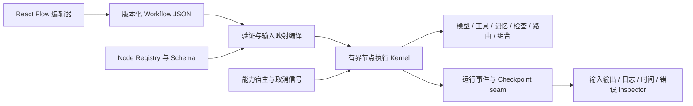

# Ramune Harness：推荐技术组合与三条路线

完成日期：2026-10-09（Asia/Shanghai）。资料快照主要采集于 2026-10-08。用户已确认采用混合复用路线，见 [ADR-0001](../adr/0001-hybrid-reuse.md)；具体依赖、版本与执行需求仍待确认。没有创建产品代码、package.json、项目脚手架、依赖锁文件或执行 Provider/编辑器集成测试。

> 极小循环。其他一切皆节点。智能是可选的。

## 推荐：混合复用，保留产品独有的图语义

用户已选择 **路线 B：混合复用**。React Flow 负责编辑交互；成熟 SDK、验证器与工具库负责各类能力；Ramune 自己定义可序列化工作流、类型化节点、端口路由、有界执行和组合卡片。它最符合用户已确定的 TypeScript + React + React Flow，也保留“没有任何 Model 节点时仍能运行”的设计。

用户已确认首版是自己的本地开发工具，并采用顺序控制流与独立能力连接，见 [ADR-0002](../adr/0002-control-flow-and-capability-binding.md)；2026-10-14 进一步确认显式上下文与可选记忆分离、有界循环、节点调用边界经确认恢复，见[访谈记录](../requirements/interview.md)、[ADR-0003](../adr/0003-explicit-context-and-optional-memory.md)及 [ADR-0004](../adr/0004-confirmed-invocation-boundary-resume.md)。插件信任仍待确认。若后续版本需要长任务自动恢复、持久人工中断、并发 join 和嵌套子图恢复，应重新评估路线 C 与 LangGraphJS，避免重造持久恢复与并发图调度引擎；仅引入 library/checkpointer 也不自动获得多 worker 的租约或分布式互斥。[LangGraph persistence](https://docs.langchain.com/oss/javascript/langgraph/persistence)、[interrupts](https://docs.langchain.com/oss/javascript/langgraph/interrupts)

“tiny”约束的是 Kernel 的职责与接口，并不是整个产品只有几十行。图编辑器、Schema 编译、权限、Trace Inspector、Provider、Check executor 与凭据管理都可以有充分实现，Kernel 仍只协调节点执行、状态传递、选边和循环终止。

## 三种方案

| 维度 | A：最小自研 | B：混合复用（推荐） | C：基于现成框架扩展 |
| --- | --- | --- | --- |
| 核心组成 | React Flow + 自有顺序图解释器 + Zod + 各厂商官方 SDK + Node 进程能力 | React Flow + 自有顺序图解释器 + Zod + AI SDK + Execa + Hono + 成熟 UI/验证组件 | React Flow + Ramune JSON→LangGraphJS 编译层 + 图节点 adapters + checkpointer；能力节点仍用 SDK/工具库 |
| 自己必须写什么 | 图语义、Provider 之间的接入 glue、进程结果/流/取消归一化、Inspector | 图语义、节点契约/注册、输入映射、Inspector、能力权限与事件关联 | workflow compiler、port↔state 映射、disabled/替换/组合卡片、事件↔Inspector 关联、图版本与权限 |
| 直接复用什么 | 画布、厂商 SDK、Schema、现成 CLI | 画布、Provider/流/工具协议、进程超时/取消、SSE、可访问 UI、测试/构建/类型检查 | 图调度、conditional routing、reducer、checkpoint/interrupt/subgraph；其余同 B |
| 最强优势 | 易理解，可在极少依赖下验证语义 | 产品语义自由，跨 Provider glue 少，重复实现 IO 最少 | 持久中断、复杂图执行与恢复可借助成熟引擎 |
| 主要代价 | 多 Provider 与进程能力的 glue 越来越多；容易重复 SDK/工具库已有功能 | checkpoint 与副作用恢复边界必须诚实；复杂并发若加入会膨胀 | 引入 state/reducer/Pregel 语义及依赖；“可连线”的字段端口仍要自己适配 |
| UI 质量 | 需自己完成 | 需自己完成 | 需自己完成；框架本身不解决产品交互 |
| 适合何时 | 概念验证/极少 Provider、极短流程 | 本地可用产品，有界循环、显式工具、重视可观察性 | 首版硬性要求可靠长任务恢复、人工中断和并发 |
| 判断 | 可行基线；禁止实现 HTTP Provider SDK/自制测试器 | **优先选择**，根据访谈裁剪依赖 | **保留切换条件**，不是因为“框架大”就排除 |

此处没有工期、速度、成本或性能的实测排名。三路线都应在需求访谈后通过同一组语义反例验证；当前阶段不提前做 PoC 或脚手架。

## 路线 B 的组件选择

| 层 | 建议 | 职责与采用方式 | 重要限制 |
| --- | --- | --- | --- |
| 语言 / 前端 | TypeScript、React | 用户已确定。类型共享用于已编写模块，导入图和运行输入仍验证 | 源码 HEAD 不等于发布版本；下一阶段建立兼容矩阵 |
| 画布 | `@xyflow/react` | **Adopt + Extend**：节点/handles/边/viewport/选择与连接，renderer 使用自有节点描述 | React Flow 不运行工作流；UI group 不自动成为组合执行图；完整 Pro 模板需订阅获取，本轮未获取源码 |
| UI 基础 | shadcn/ui 的单一 Radix base | **Adopt + Extend**：属性面板、表单、快捷命令、dialog/tabs；统一 spacing/typography/color tokens | 复制的组件由项目维护；画布可访问性/错误态/撤销不是自动获得 |
| Schema | Zod | **Adopt**：config/input/output 验证、TS inference、可表示的 JSON Schema 输出 | 不把函数/Zod 对象放入 workflow JSON，不宣称可无损转换任意 JSON Schema |
| 用户 Schema | Ajv（仅需求成立时） | **Compose** JSON Schema draft 的验证，缓存编译结果 | 任意 schema 是计算输入，也需大小/深度/ref/regex 限制；MVP 内建插件不必同时用两种验证器 |
| Provider | Vercel AI SDK Core + 所需 provider packages | **Compose** 到 Model 节点，复用消息、tool-call、流、abort、usage；不用第二套隐藏 graph loop | 各 Provider 的 tool/structured output/image/thinking 支持不一致，必须列能力矩阵；OpenAI-compatible 并非所有行为相同 |
| OpenAI 原生能力 | 官方 OpenAI JS SDK（可选专用节点） | **Compose** 原生 Responses/厂商专属能力；常规多 Provider 主路径用 AI SDK | 避免仅为相同 OpenAI 文本调用同时装两套 SDK |
| 宿主 | Node.js LTS | **Adopt** 本地执行、文件系统、异步任务；当前日期建议 Node 24 LTS | 当前 Node 26 尚处 Current；主分支安全/实验功能不自动作为 LTS 保证。[release schedule](https://github.com/nodejs/Release/blob/main/schedule.json) |
| 进程 | Execa | **Compose** Tool/Check executor：执行文件和 args、日志、timeout、cancelSignal、强杀 | 设置最小 env、opt-in killDescendants；Windows 清理 best effort；不是 sandbox |
| 本地控制接口 | Hono + `@hono/node-server` | **Compose** run 控制、流与文件查询；SSE 给 Trace Inspector | loopback + Origin/Host/session 授权，后端持有 secret；客户端断开不等于 run 取消 |
| 验证 | TypeScript CLI、Vite build、Vitest、Playwright | **Compose** 为 Check 节点和工程检查，保留成熟 CLI/reporter/artifacts | build 不替代 typecheck；Agent 生成的目标项目不必是这个技术栈，Check 指令按 workspace 配置 |
| 本地 run 存储 | 先确定恢复级别再选 | 仅审计可采用单写者 JSONL + artifacts；断点恢复要有明确 journal/checkpoint 协议 | 本报告不自行搭建 DB，不称 localStorage/MemorySaver 为持久运行恢复 |
| 执行隔离 | Docker/Moby executor（条件） | **Compose** 可选受限代码执行；公开部署再评估更强隔离 | Docker Desktop 发行条款与 Engine Apache-2.0 不同；容器配置、网络与 daemon 权限影响安全 |
| 高级 Agent | Pi CodingAgent 组合节点（后续可选） | **Compose** 已有 coding 会话/工具/压缩，以内部 span 可观察 | Pi 拥有内部 loop 和 Provider 类型；不要同时在同一层让 Kernel/SDK/Pi 管 tool retry |
| 高级图引擎 | LangGraphJS（备选） | **Extend** 若访谈证实首版恢复/并发要求，使用其已有 StateGraph/checkpointer/interrupt | 不把框架状态对象写入 vendor-neutral 的 graph JSON |

官方源码、许可证、维护与准确入口见 [复用矩阵](reuse-matrix.md) 及各证据底稿。当前 AI SDK 7 的变化和 Model/Tool 拆分证据见 [SDK 与验证材料](sdk-verification-evidence.md)。上述为组件级建议，不是已经锁定的安装清单。

## 小内核的可审查职责

建议 Kernel 接收已验证的执行图、Registry 和 ExecutionContext。它可以执行纯规则节点；Model 只是一种 node type。编译验证、编辑交互、Provider、shell 和凭据值留在独立模块。Checkpoint/事件写入是注入的接口，执行顺序与错误处理必须定义，不能把“hook”当成默认不会丢数据的理由。

先明确 control-flow：entry 激活节点，节点返回 output/state update/outcome，Kernel 按 outcome port 选边。JSON bindings 指向指定输入、state 或本轮输出；每个 activation 有独立 invocation。普通图边与显式 loop 回边区别可在编译规则中表示。并发数据流、自动全就绪调度和顺序流程不宜混为一种默认模型。

四个模板共享契约：Chat 是 Model→output；Coding Agent 是 Model→Tool→Context→Model 子图；Ralph 是重新构造每轮上下文、调用 coding 子图、用 Check/停止条件形成的外循环；自主软件开发加入任务选择/规划/实现/验证和必要人工关口。它们是用户能改的 graph，不是 Kernel 的模式开关。[Ralph 原始说明](https://ghuntley.com/ralph/)

## 最重要的取舍

### 工具由谁执行

Model 节点做一次模型请求，对本地/application-owned 工具仅暴露 tool schema，不传 SDK 的 execute callback；它输出 toolCalls。Tool 节点验证参数、请求能力授权、执行并归一化结果；Context/Memory 节点把结果附回消息。后续 Model 再被图路由激活。这样每次本地 tool invocation 才能有单独输入、输出、耗时和错误。Provider-side 托管工具在远端执行，作为单独能力标注与授权，trace 限于供应商实际提供的信息；省略 execute 不会让远端工具变成本地 Tool 节点。

单次 SDK step 不等于禁止内部工具执行。若采用 Pi 组合节点或允许 SDK 自有 Agent loop，需要明确该卡片内部有独立循环，并把内部工具 trace 映射为子 invocation；不能一方面允许其自动执行，一方面声称全由画布上的 Tool 卡控制。[SDK 证据](sdk-verification-evidence.md)、[Pi loop source](https://github.com/earendil-works/pi/blob/6fb2e7815167e6b19006fc526d1a5d0f5f998787/packages/agent/src/agent-loop.ts)

### 小调度器与可恢复长任务

MVP 可采用 invocation 边界保存；每 run 绑定 graph revision 和 node version。只有同一 invocation/attempt、loop iteration、parent invocation 与输入标识对应的 completed 结果可以恢复使用，不能按静态 node ID 缓存并跳过下一轮执行。started 但没有 durable result 的副作用为 unknown，暂停并要求检查，不能当作普通失败自动重做。Model 调用也可能重复计费；只有外部系统支持且实际使用幂等键时才能进一步保证。

DeepSeek 已显式区分工具未开始与结果未知；LangGraph 的 interrupt 恢复会重跑节点开始处的代码。复用框架也无法取消对幂等副作用的设计责任。[DeepSeek repair](https://github.com/deepseek-ai/deepseek-harness/blob/5badb15009ae1756c3afe0ae0cef1faafc290ccc/packages/core/session/src/repair.ts)、[LangGraph interrupts](https://docs.langchain.com/oss/javascript/langgraph/interrupts)

### “关闭”和“组合”的精确定义

disabled 不是任意端口自动直通。仅 identity-compatible 节点可预定义旁路，否则要求用户配置 bypass mapping，或拒绝运行。替换卡片检查所连端口、schema 与配置版本。组合卡片有独立 exposed inputs/outputs 和内部 subgraph revision；展开后保留子节点 trace，预算、取消与权限向内传播。

### 本地权限与公开部署

本地 Shell 节点的 cwd/worktree 有助于隔离变更，但进程仍有宿主用户权限。受限文件工具、受限 executable/args 和明确授权的 arbitrary shell 是不同权限。公开服务需要隔离 executor、最小挂载、网络/资源控制、租户权限和 secret store，不能把本地服务直接开放公网。[Node permissions](https://nodejs.org/api/permissions.html)、[Docker security](https://docs.docker.com/engine/security/)、[安全证据底稿](security-modularity-evidence.md)

## 产品交互需要单独验收

采用 React Flow/shadcn 能减少基础交互工作，无法自动交付专业产品。建议需求规格覆盖：可搜索节点库、明确端口类型与连接反馈、属性面板即时错误、运行/编辑状态区分、撤销重做、快捷键和键盘等效操作、空画布引导、运行中高亮、循环计数、子图展开、逐次 invocation Inspector、流式日志限量、失败定位与恢复入口、禁用/替换后的影响提示、dirty/save/version 状态。先用统一设计 token 与复用控件完成视觉体系，交互质量列入验收。[React Flow docs](https://reactflow.dev/learn)、[Radix accessibility](https://www.radix-ui.com/primitives/docs/overview/introduction)

## 改变推荐的条件

| 访谈结果 | 调整 |
| --- | --- |
| 首版必须自动恢复跨天任务/审批暂停，且有 parallel join 和 nested resume | 优先 C：LangGraphJS；直接复用真实持久化 checkpointer，明确其节点重跑语义 |
| 核心其实是单个开箱即用 Coding Agent，画布只是外围步骤 | 可优先 Compose Pi CodingAgent；不要再开发相同内部工具/会话机制 |
| Python 后端可接受、要复用 Dify 新图运行时 | 单独评估 Apache-2.0 Graphon，而非默认 fork Dify 整体；仍需匹配端口与持久化宿主 |
| 首版允许不可信工作流/第三方 JS 插件或公开多人访问 | 隔离 executor 和凭据/租户系统进入首版范围；纯本地进程方案不再满足假设 |
| Provider 仅 OpenAI，且强依 Responses 的专属能力 | AI SDK 与原生 OpenAI SDK 重新比较；不为多 Provider 的假设增加多余适配层 |

## 下一步：需求访谈，不开始实现

首版使用者已确认是用户本人，运行环境为本地。接下来依次确认编辑范围、执行/恢复语义、Provider 与工具权限、首批模板、Inspector 和质量标准。最先影响推荐的三个问题：

1. 首版要支持哪些操作系统？是否优先 Windows？
2. 首版是否要求进程重启后自动恢复，还是保存 trace 并允许用户检查后手动继续足够？
3. 首个验收场景优先可视化自由组装、Coding Agent、Ralph 迭代，还是自主交付一个完整任务？

回答后才将选定语义写入需求规格/ADR，并按用户要求另行进入产品实现。
